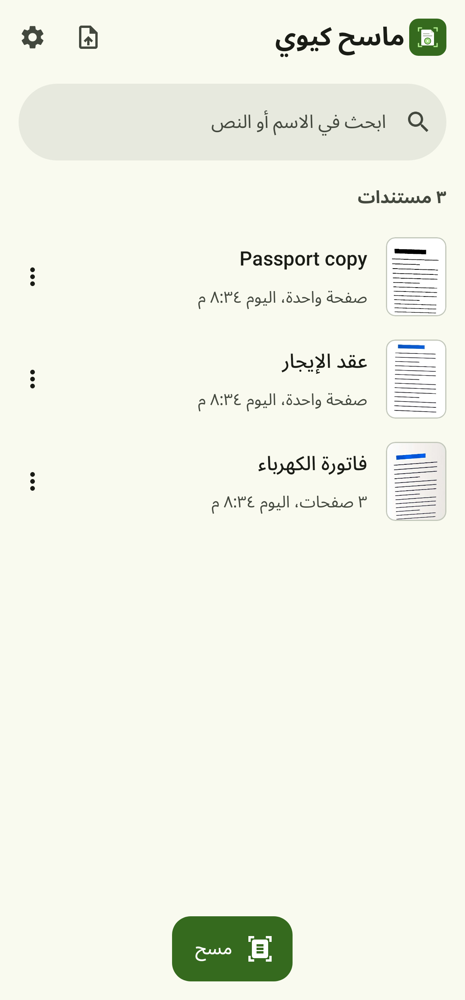
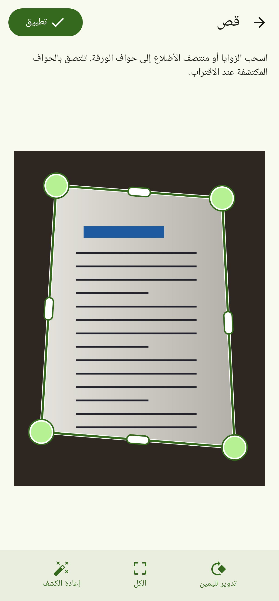
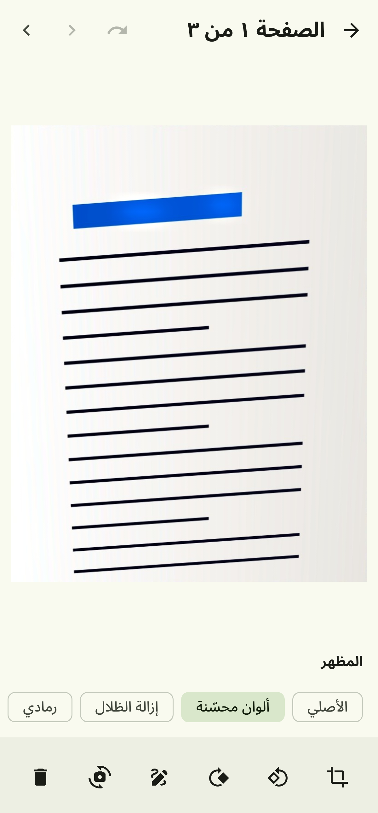
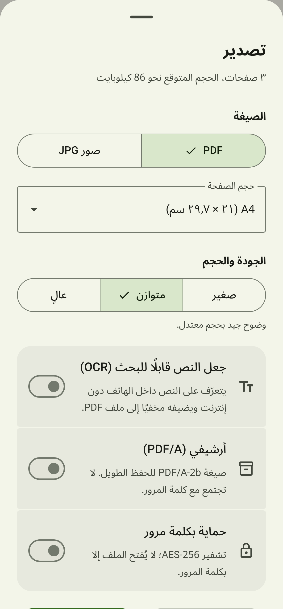

# ماسح كيوي — Scan Kiwi

<p dir="rtl">ماسح مستندات مجاني ومفتوح المصدر لأندرويد: صوّر الورق أو استورد الصور وملفات PDF، وأخرج ملف PDF واضحًا وصغيرًا وجاهزًا للمشاركة. <b>دون إنترنت، دون حساب، دون إعلانات، دون علامة مائية.</b></p>

A free, open-source document scanner for Android: capture paper or import images and PDFs, and get a clean,
small PDF ready to share. **Offline, no account, no ads, no watermark.**

|  |  |  |  |
|---|---|---|---|

<sub>لقطات اصطناعية مولّدة في الاختبارات، لا تحتوي مستندات حقيقية — Synthetic screenshots generated by the test suite; no real documents.</sub>

---

<div dir="rtl">

## بالعربية

### ما هو
- مسح بالكاميرا مع كشف حواف الورقة والتقاط تلقائي، وقص يدوي سهل (زوايا ومقابض أضلاع وعدسة تكبير).
- تصحيح المنظور، ومظاهر: الأصلي، ألوان محسّنة، إزالة الظلال، رمادي، أبيض وأسود.
- مستندات متعددة الصفحات: ترتيب، تدوير، حذف، إعادة تصوير، تراجع.
- استيراد صور وملفات PDF ودمجها. توقيع. نسخة بطاقة هوية بوجهيها.
- تصدير PDF بأحجام A4 وLetter وLegal وA5، مع ضغط مناسب لواتساب، ونص قابل للبحث (OCR عربي وإنجليزي دون إنترنت)، وكلمة مرور AES-256، وخيار أرشيفي PDF/A-2b. وتصدير JPG.
- عربي أولًا مع الإنجليزية، واجهة من اليمين لليسار، ودعم قارئ الشاشة.

### المتطلبات
أندرويد 7.0 فما فوق (API 24+). الإذن الوحيد: الكاميرا.

### الخصوصية
- يتصل سكان كيوي بالإنترنت فقط للتحقق من التحديثات وتنزيلها من GitHub. لا يُرسل أي ملف أو صورة أو بيانات عنك. يمكنك إيقافه من الإعدادات.
- الأذونات: الكاميرا، والإنترنت وحالة الشبكة وتثبيت الحزم للتحديث فقط؛ يتحقق CI من القائمة في كل بناء، ومن أن كود الشبكة الوحيد هو `update/UpdateClient.kt` (GitHub وHTTPS فقط).
- المستندات في مساحة التطبيق الخاصة، والنسخ الاحتياطي السحابي معطّل لها. لا يخرج ملف إلا حين تختار «مشاركة» أو «حفظ».
- لا تتبّع، ولا إحصاءات، ولا إعلانات، ولا حسابات.
- «أبلغنا عن مشكلة أو اقتراح» يفتح بريدك أو المتصفح بنص تراه قبل إرساله؛ لا يُرسل مستند أو صورة أبدًا.

**التحديثات (منذ 2.0):** يتحقق التطبيق من إصداراته على GitHub مرة كل ٧ أيام على الأكثر عند فتحه (يمكن إيقافه)، وبزر «تحقق من التحديثات» في الإعدادات ← التحديثات أو «حول». لا يُنزَّل شيء إلا بلمستك، وعبر Wi-Fi فقط افتراضياً. لا يُثبَّت تحديث إلا إذا كان أحدث، وطابقت بصمته (SHA-256) ملف SHA256SUMS في الإصدار نفسه، ووُقّع بمفتاح التطبيق نفسه، ثم بموافقتك في شاشة أندرويد. الطلب لا يحمل أي معرّف للجهاز؛ يرى GitHub عنوان IP الخاص بك كأي موقع. ما زال بإمكانك استعمال Obtainium أو التحديث يدوياً من صفحة الإصدارات.

### التثبيت (ليس على Google Play)
التطبيق غير منشور على Google Play. نزّل ملف `ScanKiwi-X.Y.Z.apk` من [صفحة الإصدارات](https://github.com/sarmadiq9090-coder/scan-kiwi/releases/latest) ثم:
1. افتح الملف على الهاتف.
2. إن ظهرت رسالة «تثبيت تطبيقات غير معروفة»: اضغط «الإعدادات» وفعّل «السماح من هذا المصدر» للتطبيق الذي فتحت منه الملف، ثم ارجع واضغط «تثبيت».
3. إن نبّهك Play Protect: «مزيد من التفاصيل» ثم «التثبيت على أي حال» (السبب أن التطبيق ليس من المتجر).

### التحديثات
- **تلقائيًا عبر Obtainium** (تطبيق مستقل): [أضف ماسح كيوي إلى Obtainium](https://apps.obtainium.imranr.dev/redirect?r=obtainium://add/https://github.com/sarmadiq9090-coder/scan-kiwi)، أو من داخل التطبيق: الإعدادات ◂ التحديثات ◂ «حدّثه تلقائياً عبر Obtainium».
- **يدويًا**: نزّل أحدث APK من صفحة الإصدارات وثبّته فوق القديم؛ تبقى مستنداتك.
- بصمة شهادة التوقيع (SHA-256) أدناه. **يرفض أندرويد أي تحديث غير موقّع بهذه الشهادة.**

### التحقق من الملف
قارن بصمة SHA-256 للملف بما في `SHA256SUMS.txt` في صفحة الإصدار:
- ويندوز: `Get-FileHash ScanKiwi-1.2.0.apk -Algorithm SHA256`
- لينكس/ماك: `sha256sum ScanKiwi-1.2.0.apk`

وللتحقق من التوقيع: `apksigner verify --print-certs ScanKiwi-1.2.0.apk`
ويجب أن تكون بصمة الشهادة:
`26e5ed001c7343de4eac67086be4ddade5b39cae8029c72b552b057bdf2dcce6`

### البناء من المصدر
راجع قسم «Build from source» بالإنجليزية أدناه.

### الترخيص
الشيفرة مرخّصة بـ [Apache-2.0](LICENSE). المكوّنات الخارجية وتراخيصها في [THIRD_PARTY.md](THIRD_PARTY.md).
**الاسم «ماسح كيوي / Scan Kiwi» و«FastKiwi» والأيقونة ليست مرخّصة للاستخدام** (المادة 6 من رخصة Apache-2.0): إن نشرت نسخة معدّلة فاستعمل اسمًا وأيقونة مختلفين.

### المساهمة والأمان
المشكلات والاقتراحات مرحّب بها عبر Issues. طلبات الدمج غير مقبولة حاليًا ([CONTRIBUTING.md](CONTRIBUTING.md)).
الثغرات الأمنية: [SECURITY.md](SECURITY.md).

</div>

---

## English

### What it does
- Camera scanning with live page detection and auto capture; easy manual crop (corners, side handles, magnifier).
- Perspective correction and looks: Original, Enhanced colour, Remove shadows, Grayscale, Black & white.
- Multi-page documents: reorder, rotate, delete, retake, undo.
- Import images and PDFs and merge them. Signature. Two-sided ID-card copy.
- PDF export in A4, Letter, Legal, A5 or fit-to-image, with a WhatsApp-friendly small size, searchable text
  (offline Arabic + English OCR), AES-256 password, and an archival PDF/A-2b option. JPG export too.
- Arabic first with English, full right-to-left layout, TalkBack support.

### Requirements
Android 7.0+ (API 24+). Permissions: the camera, and since 2.0 internet, network state and install packages for the update check only.

### Privacy
- Scan Kiwi connects to the internet only to check for and download updates from GitHub. It sends no file, photo or data about you. You can turn this off in Settings.
- CI checks the exact permission list on every build, and that `update/UpdateClient.kt` (GitHub only, HTTPS only)
  is the only network code.
- Documents stay in the app's private storage and are excluded from cloud backup. A file leaves the phone only
  when you choose Share or Save.
- No tracking, analytics, ads or accounts.
- "Report a problem or suggestion" opens your own mail app or browser with a text you review before sending;
  documents and images are never attached.

**Updates (since 2.0):** the app checks its GitHub releases at most once every 7 days when you open it (you can turn this off), and with «Check for updates» in Settings → Updates or About. Nothing is downloaded without your tap, and only over Wi-Fi by default. An update is installed only if it is newer, its fingerprint (SHA-256) matches the SHA256SUMS file of the same release and it is signed with this app's own key, and then only when you confirm on Android's screen. Requests carry no device identifier; GitHub sees your IP address, as with any website. You can still use Obtainium or update by hand from the releases page.

### Install (not on Google Play)
Scan Kiwi is not published on Google Play. Download `ScanKiwi-X.Y.Z.apk` from the
[releases page](https://github.com/sarmadiq9090-coder/scan-kiwi/releases/latest), then:
1. Open the file on your phone.
2. If Android says installing unknown apps is not allowed: tap Settings, allow "this source" for the app you
   opened the file from, go back and tap Install.
3. If Play Protect warns you: "More details" then "Install anyway" (it warns because the app is not from the store).

### Updates
- **Automatically with Obtainium** (an independent app):
  [add Scan Kiwi to Obtainium](https://apps.obtainium.imranr.dev/redirect?r=obtainium://add/https://github.com/sarmadiq9090-coder/scan-kiwi),
  or in the app: Settings ▸ Updates ▸ "Auto-update with Obtainium".
- **By hand**: download the latest APK from the releases page and install it over the old one; your documents stay.
- Signing-certificate SHA-256 below. **Android refuses any update that is not signed with this certificate.**

### Verify the download
Compare the APK's SHA-256 with `SHA256SUMS.txt` on the release page:
- Windows: `Get-FileHash ScanKiwi-1.2.0.apk -Algorithm SHA256`
- Linux/macOS: `sha256sum ScanKiwi-1.2.0.apk`

Check the signature with `apksigner verify --print-certs ScanKiwi-1.2.0.apk`; the certificate SHA-256 must be:
`26e5ed001c7343de4eac67086be4ddade5b39cae8029c72b552b057bdf2dcce6`

### Provenance (honest note)
Release APKs are built and **signed on the maintainer's PC**, not in CI, so there is no GitHub build attestation.
Each release ships an SBOM (`ScanKiwi-X.Y.Z.cdx.json`, CycloneDX) and an **unsigned** in-toto SLSA v1 provenance
statement (`ScanKiwi-X.Y.Z.intoto.jsonl`, SLSA Build L1) naming the local builder, source commit, toolchain and
the APK digest. CI independently builds an unsigned APK from the same commit and runs all tests.

### Build from source
Requirements: JDK 21 (Temurin), Android SDK platform 36 and build-tools 36.0.0.

```
git clone https://github.com/sarmadiq9090-coder/scan-kiwi.git
cd scan-kiwi
./gradlew :app:testDebugUnitTest     # JVM + Robolectric tests (screenshots go to screenshots/)
./gradlew :app:assembleRelease       # unsigned APK unless keystore/keystore.properties exists
./gradlew :app:releaseSbom           # dist/ScanKiwi-<version>.cdx.json
```

Dependencies are checked against `gradle/verification-metadata.xml` (SHA-256), and the Gradle wrapper
distribution against its pinned SHA-256. See [STANDARDS.md](STANDARDS.md) for reproducibility notes.

### Project layout
- `core/` – pure Kotlin, unit-tested: page detection, crop geometry, filters, PDF writer (AES-256, PDF/A), auto-capture.
- `imaging/`, `ocr/`, `export/`, `data/` – Android image I/O, Tesseract OCR, export pipeline, storage.
- `feedback/` – report links (mail / GitHub issue) built without any network access.
- `ui/` – Jetpack Compose (Material 3) screens.

### Licence
Code: [Apache-2.0](LICENSE). Third-party components and licences: [THIRD_PARTY.md](THIRD_PARTY.md).
**The names "Scan Kiwi", «ماسح كيوي» and "FastKiwi" and the app icon are not licensed for use** (Apache-2.0
§6, trademarks): if you publish a modified version, give it a different name and icon.

### Contributing and security
Issues are welcome; pull requests are not accepted for now ([CONTRIBUTING.md](CONTRIBUTING.md)).
Security reports: [SECURITY.md](SECURITY.md). Code of conduct: [CODE_OF_CONDUCT.md](CODE_OF_CONDUCT.md).
Changes: [CHANGELOG.md](CHANGELOG.md).
